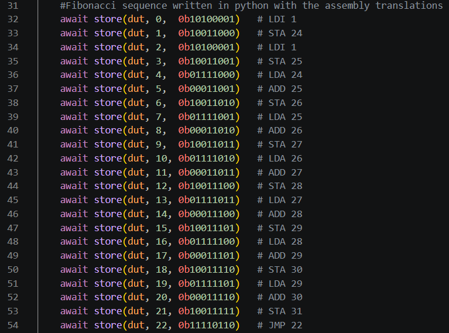

<!---

This file is used to generate your project datasheet. Please fill in the information below and delete any unused
sections.

You can also include images in this folder and reference them in the markdown. Each image must be less than
512 kb in size, and the combined size of all images must be less than 1 MB.
-->

## How it works

This is a simple 8 bit cpu with 8 instructions and 32 8-bit registers that store both operations and values.
It uses a 3 bit opcode to determine the operation, and 5 bit value to either point to one of the 32 memory locations or pass into as a value for the operation.

## How to test

To load, use the load pin as described in info.yaml to upload programs to the memory location ADDR[4:0], uploading DATA[7:0] whenever the clock in on.

To run the loaded program, set reset to high and load to 0, and the CPU will run one instruction per clock cycle.

### Example program: Fibonacci

This is a simple example program that calculates sequential numbers in a fibonacci sequence. Lines 32-35 upload two 1's as the seed numbers for the sequence. Then, the nth memory location is filled by first taking the n-2 memory location's value and placing it in the accumulator, and adding it to the value of mem[n-1]. Every time the ADD operation completes, the value is sent to the accumulator, and at that clock, it is the value reflected in the 8 output pins. 

