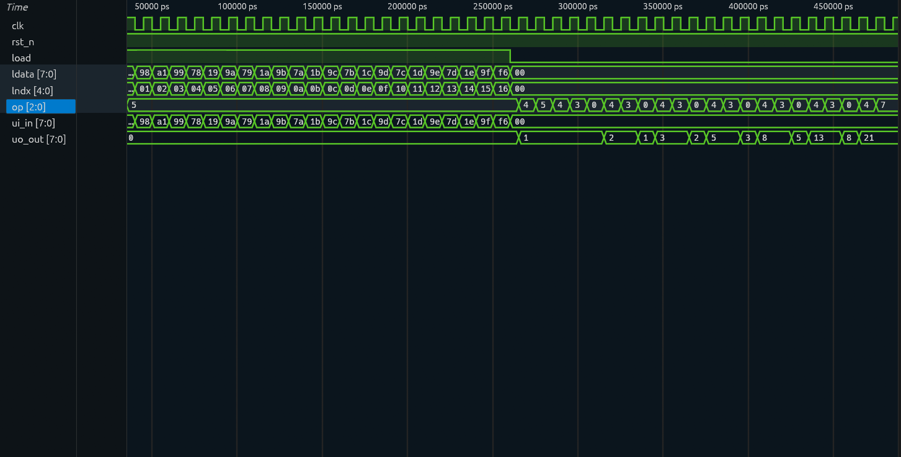
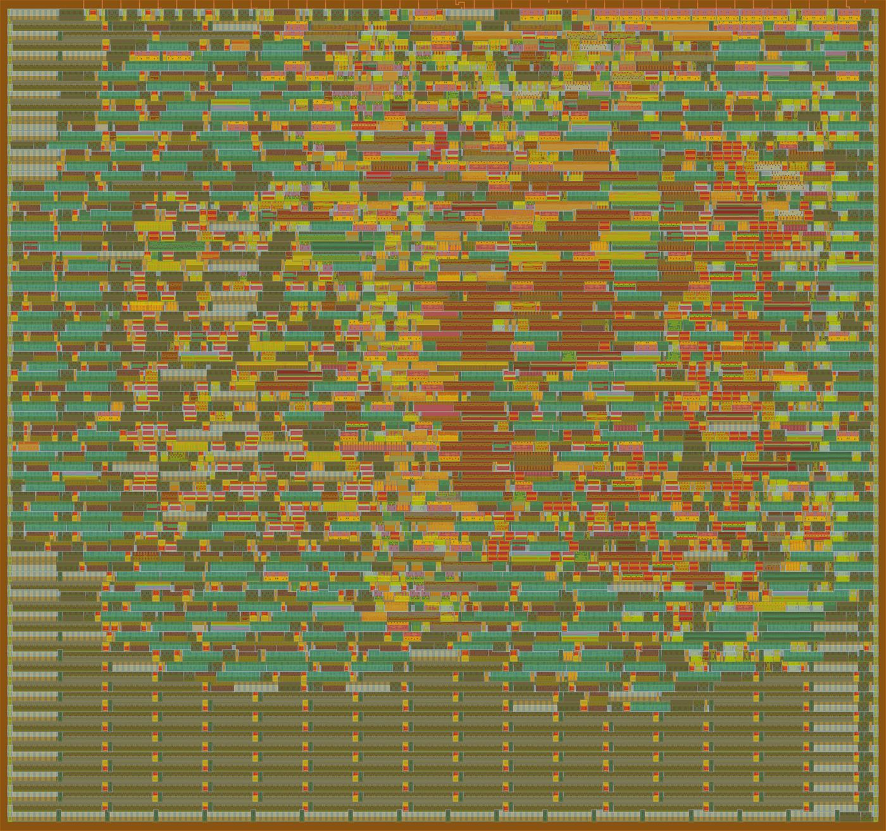

<!---

This file is used to generate your project datasheet. Please fill in the information below and delete any unused
sections.

You can also include images in this folder and reference them in the markdown. Each image must be less than
512 kb in size, and the combined size of all images must be less than 1 MB.
-->

## How it works

This is a simple 8 bit cpu with 8 instructions and 32 8-bit registers that store both operations and values.
It uses a 3 bit opcode to determine the operation, and 5 bit value to either point to one of the 32 memory locations or pass into as a value for the operation.

The operation set is ADD ,SUB , NOR, LDA, STA, LDI, BEQ, and JMP, and there are 32 registers, each containing one byte, which are indexed by the 5 data bits for the memory location index in the ADD, SUB, NOR, LDA, and STA operations. LDI uses the 5 data bits as a value to input into the accumulator. JMP and BEQ are there for loop control.

## How to test

To load, use the load pin as described in info.yaml to upload programs to the memory location ADDR[4:0], uploading DATA[7:0] whenever the clock in on.

To run the loaded program, set reset to high and load to 0, and the CPU will run one instruction per clock cycle.

### Example program: Fibonacci

This is a simple example program that calculates sequential numbers in a fibonacci sequence. Lines 32-35 upload two 1's as the seed numbers for the sequence. Then, the nth memory location is filled by first taking the n-2 memory location's value and placing it in the accumulator, and adding it to the value of mem[n-1]. Every time the ADD operation completes, the value is sent to the accumulator, and at that clock, it is the value reflected in the 8 output pins. 

## Waveform Analysis

On the left half of the waveform, the load pin is high, so the program is being uploaded and stored in registers 0-22, inclusive (waveform shows hex values). On the right half, the load pin is low and the program executes, and the CPU outputs the next Fibonacci number every third clock cycle, which is because it takes one clock to retrieve the Fibonacci number before the last one, another to add it to the following last number, and a third clock to store the value from the accumulator into the correct register.

## Chip Layout

The design is laid out on a 1x2 tile in the GF180MCU process, with a die size of about 346 x 325 um. It uses 1,963 standard cells (not counting fill and tap cells), 269 of which are flip-flops: 256 for the 32 memory registers, 8 for the accumulator, and 5 for the program counter. The cells fill about 60% of the core area, and the layout passes the DRC, LVS, and antenna checks with no errors

